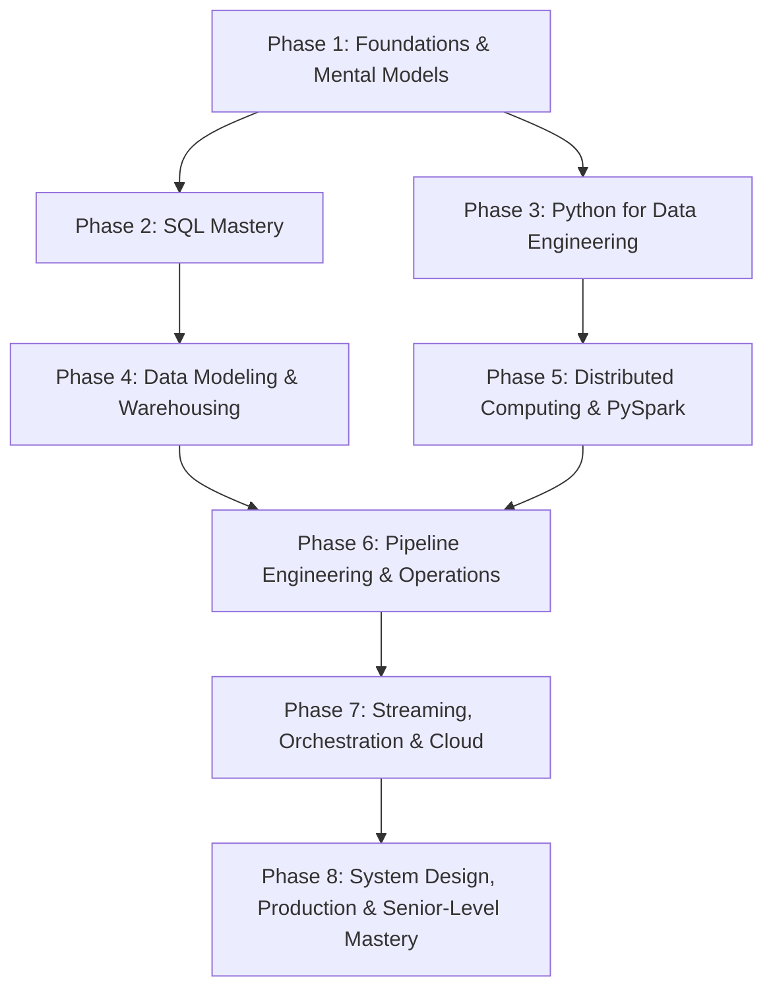
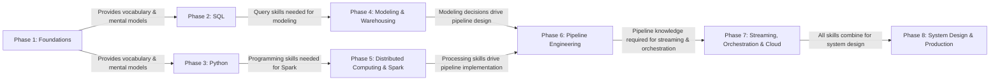

# Data Engineering Mastery Roadmap

> **Philosophy**: Ye roadmap ek linear syllabus nahi hai — ye ek **dependency graph** hai. Har phase pichle phase ki foundation pe build karta hai. Koi bhi topic isolation mein nahi seekhenge — har concept ko real-world context, production mindset, aur interview lens se dekhenge.

---

## Roadmap Structure — 8 Phases

---

## Phase 1 — Foundations & Mental Models
**Duration Estimate**: 2–3 weeks | **Prerequisite**: None

> Ye phase sabse zyada underestimated hai. Log seedha SQL ya Spark pe kood jaate hain, but bina foundation ke aage jaake har decision weak hota hai. Yahaan hum Data Engineering ka "thinking framework" build karenge.

### Module 1.1 — What is Data Engineering?
| # | Topic | Why It Matters |
|---|-------|---------------|
| 1 | What a Data Engineer actually does (not the textbook version) | Role clarity — interview mein "Tell me about your role" ka strong answer |
| 2 | Data Engineer vs Data Scientist vs Data Analyst vs Analytics Engineer vs ML Engineer | Boundary clarity — what's your job and what's NOT |
| 3 | The Data Lifecycle: Generation → Collection → Ingestion → Storage → Processing → Serving → Archival | Every DE decision maps to a stage in this lifecycle |
| 4 | Data Sources in the real world: databases, APIs, files, SaaS, logs, events, IoT | You can't build pipelines if you don't understand where data comes from |

### Module 1.2 — Data Types & Storage Paradigms
| # | Topic | Why It Matters |
|---|-------|---------------|
| 5 | Structured vs Semi-structured vs Unstructured data | Storage, processing, and modeling decisions depend on this |
| 6 | OLTP vs OLAP — deep intuition, not just definitions | This distinction drives EVERYTHING in data architecture |
| 7 | Row-oriented vs Column-oriented storage | Performance intuition for warehouses and file formats |
| 8 | File formats: CSV, JSON, Parquet, ORC, Avro — when and why | Wrong format = 10x cost, 10x slowness |

### Module 1.3 — Core Data Engineering Concepts
| # | Topic | Why It Matters |
|---|-------|---------------|
| 9 | ETL vs ELT — actual trade-offs, not just acronym expansion | Architecture-defining decision |
| 10 | Batch vs Streaming — when each makes sense (and when neither is pure) | Most real systems are hybrid; understanding why is key |
| 11 | Data Pipelines — what they actually are, components, failure modes | The core "product" a DE builds |
| 12 | Data Warehouses vs Data Lakes vs Lakehouses — evolution and trade-offs | Modern architecture decisions |

### Module 1.4 — Engineering Properties (Non-Negotiables)
| # | Topic | Why It Matters |
|---|-------|---------------|
| 13 | Latency, Throughput, Scalability | Performance vocabulary |
| 14 | Reliability, Availability, Consistency (intro-level, not distributed systems depth) | "Will the pipeline work when it matters?" |
| 15 | Fault Tolerance & Idempotency | The two most important DE properties after correctness |
| 16 | Reprocessing & Backfills | Every pipeline WILL need reprocessing someday |
| 17 | Schema Evolution & Data Contracts | "What happens when upstream changes?" |
| 18 | Data Lineage & Metadata | Observability and debugging depend on these |

> [!IMPORTANT]
> **Interview Integration**: Phase 1 ke baad, main tumse puchunga: *"You join a company on Day 1. The data team has no data warehouse, multiple CSV files on shared drives, manual Excel reports, and growing data volumes. How would you assess the situation and propose a path forward?"* — This tests whether you can THINK like a DE, not just code.

---

## Phase 2 — SQL Mastery (Beginner → Expert)
**Duration Estimate**: 6–8 weeks | **Prerequisite**: Phase 1

> SQL is the most important skill for a Data Engineer. Period. Spark seekh lo, Python seekh lo — agar SQL weak hai, toh interview bhi crack nahi hoga aur production mein bhi struggle karoge. Yahan hum SQL ko syntax se start karke optimization, internals, aur expert-level problem solving tak le jaayenge.

### Module 2.1 — SQL Fundamentals
| # | Topic | Key Concepts |
|---|-------|-------------|
| 1 | SELECT, FROM — logical query processing order | SQL ka execution order (FROM → WHERE → GROUP BY → HAVING → SELECT → ORDER BY → LIMIT) |
| 2 | WHERE — filtering, comparison operators, AND/OR precedence | Operator precedence traps, NULL in WHERE |
| 3 | NULL — the billion-dollar misunderstanding | Three-valued logic, NULL in comparisons, NULL in aggregations, NULL in JOINs, COALESCE, NULLIF, IS NULL vs = NULL |
| 4 | ORDER BY, DISTINCT, LIMIT | Determinism issues, DISTINCT on multiple columns, LIMIT without ORDER BY |
| 5 | Data Types & Type Conversion | Implicit vs explicit casting, precision loss, date/timestamp types, string-to-number traps |
| 6 | CASE expressions | Simple CASE, searched CASE, CASE in WHERE/ORDER BY/aggregation, NULL handling in CASE |
| 7 | String functions | CONCAT, SUBSTRING, TRIM, REPLACE, LIKE, REGEXP, LENGTH — real-world data cleaning |
| 8 | Date/Time functions | DATE_TRUNC, DATE_DIFF, DATE_ADD, EXTRACT, timezone handling, epoch conversions |

### Module 2.2 — Aggregation
| # | Topic | Key Concepts |
|---|-------|-------------|
| 9 | GROUP BY & Aggregation functions | COUNT, SUM, AVG, MIN, MAX — what happens with NULLs |
| 10 | COUNT(*) vs COUNT(col) vs COUNT(DISTINCT col) | The classic interview trap |
| 11 | HAVING | Filtering after aggregation, HAVING vs WHERE |
| 12 | Conditional aggregation | SUM(CASE...), COUNT(CASE...), FILTER clause — pivot-like behavior without PIVOT |
| 13 | Grouping edge cases | GROUP BY with NULLs, empty groups, aggregation without GROUP BY |

### Module 2.3 — Joins (Deep Dive)
| # | Topic | Key Concepts |
|---|-------|-------------|
| 14 | INNER JOIN | Matching logic, join predicate, multi-column joins |
| 15 | LEFT / RIGHT / FULL OUTER JOIN | NULL introduction, outer join filtering traps (WHERE vs ON) |
| 16 | CROSS JOIN | Cartesian product, legitimate use cases (date spines, parameter expansion) |
| 17 | SELF JOIN | Hierarchical data, comparisons within same table |
| 18 | Semi Joins & Anti Joins | EXISTS/NOT EXISTS vs IN/NOT IN — performance and NULL behavior |
| 19 | Join Cardinality & Explosion | 1:1, 1:N, M:N — why row count changes, duplicate multiplication |
| 20 | Join Internals | Hash Join, Nested Loop Join, Sort-Merge Join — when each is chosen |

> [!WARNING]
> **Common Trap**: `LEFT JOIN` ke baad `WHERE right_table.column = value` likhna effectively INNER JOIN bana deta hai. Ye interview mein bahut commonly test hota hai, aur production mein bahut commonly bugs create karta hai.

### Module 2.4 — Subqueries & CTEs
| # | Topic | Key Concepts |
|---|-------|-------------|
| 21 | Scalar subqueries | Single-value subqueries, subquery in SELECT/WHERE |
| 22 | Correlated subqueries | Per-row execution, performance implications |
| 23 | EXISTS / NOT EXISTS | Row existence check, correlated pattern |
| 24 | IN / NOT IN | Set membership, NULL trap in NOT IN |
| 25 | Derived tables (subqueries in FROM) | Inline views, query decomposition |
| 26 | CTEs — Common Table Expressions | Readability, reusability, multiple CTEs |
| 27 | Recursive CTEs | Hierarchical data, graph traversal, termination conditions |
| 28 | CTE optimization considerations | Materialization behavior (varies by engine), CTE vs subquery vs temp table |

### Module 2.5 — Window Functions (The Most Important SQL Topic for DEs)
| # | Topic | Key Concepts |
|---|-------|-------------|
| 29 | Window functions — intuition | "Aggregation without collapsing rows" — PARTITION BY as virtual GROUP BY |
| 30 | ROW_NUMBER, RANK, DENSE_RANK | Ranking, deduplication, tie handling |
| 31 | LAG, LEAD | Previous/next row access, gap detection, change detection |
| 32 | FIRST_VALUE, LAST_VALUE | Extremes within partition, LAST_VALUE frame trap |
| 33 | SUM/AVG/COUNT as window functions | Running totals, cumulative metrics |
| 34 | Window Frames — ROWS vs RANGE | Default frame, UNBOUNDED PRECEDING, CURRENT ROW, N PRECEDING/FOLLOWING |
| 35 | Moving averages, running totals | Frame-based calculations, business analytics |
| 36 | NTILE, PERCENT_RANK, CUME_DIST | Distribution functions, percentile calculations |

> [!TIP]
> Window functions Data Engineering interviews ka **single most tested SQL topic** hai. Deduplication (ROW_NUMBER), change detection (LAG), running metrics (SUM OVER), aur sessionization — sab window functions se aate hain.

### Module 2.6 — Advanced SQL for Data Engineering
| # | Topic | Key Concepts |
|---|-------|-------------|
| 37 | Deduplication patterns | ROW_NUMBER, QUALIFY, GROUP BY approaches — trade-offs |
| 38 | Gaps and Islands | Consecutive sequences, session detection |
| 39 | Top-N per group | ROW_NUMBER vs RANK vs lateral join approaches |
| 40 | Sessionization | Activity-based sessions using LAG + SUM |
| 41 | Cohort analysis | User retention, period-over-period analysis |
| 42 | Funnel analysis | Sequential event analysis, conversion rates |
| 43 | Time-series patterns | Date spines, period filling, year-over-year |
| 44 | Pivot / Unpivot | Conditional aggregation, PIVOT operator, UNPIVOT/CROSS JOIN UNNEST |
| 45 | JSON & semi-structured querying | JSON extraction, array flattening, nested data |
| 46 | Set operations | UNION, UNION ALL, INTERSECT, EXCEPT — deduplication behavior |
| 47 | MERGE / UPSERT | Conditional insert/update/delete, SCD implementation |
| 48 | Slowly Changing Dimensions in SQL | SCD Type 1, 2, 3 implementation with SQL |
| 49 | Incremental transformation patterns | High-water mark, change detection, idempotent SQL |

### Module 2.7 — SQL Performance & Internals
| # | Topic | Key Concepts |
|---|-------|-------------|
| 50 | Logical query processing order (deep) | Why knowing this prevents bugs |
| 51 | Query execution plans — reading and interpreting | EXPLAIN, cost estimation, actual vs estimated rows |
| 52 | Indexes — B-tree, bitmap, clustered, non-clustered | When indexes help, when they hurt |
| 53 | Table partitioning | Partition pruning, partition strategies |
| 54 | Clustering / sort keys | Data organization for scan efficiency |
| 55 | Predicate pushdown | Filter early, scan less |
| 56 | Join strategies in execution | Hash join, sort-merge join, nested loop — optimizer choices |
| 57 | Statistics & cardinality estimation | Why optimizer makes wrong choices |
| 58 | Materialized views | Precomputation, refresh strategies, trade-offs |
| 59 | Common anti-patterns & optimization | SELECT *, unnecessary DISTINCT, correlated subqueries, implicit casting |

> **Interview Integration**: Har 5–7 topics ke baad, ek SQL coding round simulate karenge — easy se start, gradually expert-level tak.

---

## Phase 3 — Python for Data Engineering
**Duration Estimate**: 4–5 weeks | **Prerequisite**: Phase 1

> Ye generic Python course NAHI hai. Yahan sirf woh Python seekhenge jo Data Engineering mein actually use hoti hai — file handling, API ingestion, data processing, error handling, testing, aur production-grade scripting.

### Module 3.1 — Python Fundamentals (DE-Focused)
| # | Topic | Why for DE |
|---|-------|-----------|
| 1 | Data structures: list, dict, set, tuple, defaultdict, Counter | Data manipulation, lookup optimization |
| 2 | List/dict comprehensions, generator expressions | Memory-efficient data processing |
| 3 | Functions: args, kwargs, first-class functions | Pipeline building blocks |
| 4 | Iterators & Generators | Large file processing without memory explosion |
| 5 | Exception handling: try/except/else/finally | Pipeline error handling |
| 6 | Context managers (with statement) | File/connection resource management |
| 7 | Type hints | Production code readability & maintainability |
| 8 | OOP essentials (classes, inheritance, composition) | Pipeline frameworks, connector design |

### Module 3.2 — File & Data Handling
| # | Topic | Why for DE |
|---|-------|-----------|
| 9 | File I/O: text, CSV, JSON, Parquet | Data ingestion & export |
| 10 | Working with large files (streaming reads, chunking) | Memory-bounded processing |
| 11 | CSV edge cases: encoding, delimiters, quoting, malformed rows | Real-world data is messy |
| 12 | JSON: nested structures, JSON Lines, schema validation | API responses, semi-structured data |
| 13 | datetime handling, timezone awareness | Temporal data processing |
| 14 | Regular expressions for data cleaning | Pattern matching, extraction, validation |

### Module 3.3 — API & Data Ingestion
| # | Topic | Why for DE |
|---|-------|-----------|
| 15 | HTTP fundamentals: methods, status codes, headers | API integration basics |
| 16 | requests library: GET, POST, authentication | API data extraction |
| 17 | Pagination patterns: offset, cursor, keyset | Complete data extraction |
| 18 | Rate limiting & throttling | Respectful API consumption |
| 19 | Retry logic & exponential backoff | Resilient ingestion |
| 20 | OAuth, API keys, token refresh | Authentication patterns |
| 21 | Error handling for API ingestion | Partial failures, timeout, connection errors |
| 22 | Building a production-grade API ingestion script | Putting it all together |

### Module 3.4 — Production Python
| # | Topic | Why for DE |
|---|-------|-----------|
| 23 | Logging (not print statements) | Production observability |
| 24 | Configuration management | Environment-specific settings |
| 25 | Environment variables & secrets | Security |
| 26 | Virtual environments, dependency management | Reproducibility |
| 27 | Unit testing with pytest | Code quality |
| 28 | Mocking: external services, databases, APIs | Testability |
| 29 | Concurrency: threading, multiprocessing, asyncio | Parallel ingestion, I/O-bound tasks |
| 30 | Memory profiling & performance | Resource optimization |
| 31 | Packaging & project structure | Maintainable codebases |

> **Interview Integration**: Python coding round mein typically file processing, API ingestion, data transformation, aur edge-case handling problems aate hain. SQL ke saath parallel practice chalegi.

---

## Phase 4 — Data Modeling & Warehousing
**Duration Estimate**: 5–6 weeks | **Prerequisite**: Phase 2 (SQL Mastery)

> Data Modeling interviews mein sabse zyada candidates fail hote hain kyunki unhe "grain" ka concept properly nahi aata. Yahan hum bottom-up modeling seekhenge — pehle business problem, phir grain, phir dimensions, phir facts.

### Module 4.1 — Modeling Fundamentals
| # | Topic | Key Concepts |
|---|-------|-------------|
| 1 | Why data modeling matters — the cost of bad models | Query performance, data integrity, usability |
| 2 | OLTP modeling: normalization (1NF, 2NF, 3NF, BCNF) | Reducing redundancy, maintaining integrity |
| 3 | OLAP modeling: denormalization — why and when | Read optimization, query simplicity |
| 4 | Normalization vs Denormalization — the real trade-off | Write performance vs read performance, storage vs compute |
| 5 | Entity-Relationship modeling | Entities, relationships, cardinality |

### Module 4.2 — Dimensional Modeling (Kimball)
| # | Topic | Key Concepts |
|---|-------|-------------|
| 6 | Dimensional modeling — intuition | "Organize data around business processes and measurements" |
| 7 | **Grain** — the single most important concept | Define grain BEFORE designing any fact table |
| 8 | Fact tables: types and design | Transaction facts, periodic snapshots, accumulating snapshots |
| 9 | Dimension tables: design principles | Descriptive attributes, hierarchies, denormalized |
| 10 | Star schema | Fact at center, dimensions around it — simplicity and performance |
| 11 | Snowflake schema | Normalized dimensions — when and why (hint: rarely) |
| 12 | Surrogate keys vs Natural keys | Why surrogate keys in warehouses, when natural keys are okay |

### Module 4.3 — Advanced Dimensional Modeling
| # | Topic | Key Concepts |
|---|-------|-------------|
| 13 | Slowly Changing Dimensions — Type 0 | Fixed attributes, no changes tracked |
| 14 | SCD Type 1 | Overwrite, no history |
| 15 | **SCD Type 2** (deep dive) | Full history, effective dates, current flag, surrogate keys |
| 16 | SCD Type 3 | Previous value column, limited history |
| 17 | Hybrid SCD approaches | Type 2 + Type 1 combined |
| 18 | Conformed dimensions | Shared dimensions across fact tables |
| 19 | Role-playing dimensions | Same dimension, different roles (order_date, ship_date) |
| 20 | Degenerate dimensions | Dimension attributes in fact table (invoice number) |
| 21 | Junk dimensions | Grouping miscellaneous flags/indicators |
| 22 | Bridge tables | Many-to-many relationships |
| 23 | Factless fact tables | Events without measures (student attendance) |
| 24 | Late-arriving dimensions & facts | How to handle data that arrives out of order |

### Module 4.4 — Advanced Modeling Patterns
| # | Topic | Key Concepts |
|---|-------|-------------|
| 25 | Snapshot tables — periodic snapshots | Balance, inventory, account status at a point in time |
| 26 | Accumulating snapshot facts | Lifecycle tracking (order → ship → deliver) |
| 27 | Event modeling / Activity schema | Wide events, semi-structured attributes |
| 28 | Temporal modeling | Valid time vs transaction time, bitemporal |
| 29 | Data Vault (overview) | Hub, link, satellite — when Data Vault makes sense |
| 30 | One Big Table (OBT) approach | Extreme denormalization — trade-offs |
| 31 | Modeling for specific domains | E-commerce, finance, subscriptions, events |

### Module 4.5 — Data Warehouse Architecture
| # | Topic | Key Concepts |
|---|-------|-------------|
| 32 | Warehouse architecture layers | Staging → Raw/Bronze → Transformed/Silver → Curated/Gold → Serving |
| 33 | Staging area design | Raw data landing, minimal transformation |
| 34 | ODS (Operational Data Store) | Near-real-time operational reporting |
| 35 | Data marts | Department-specific data subsets |
| 36 | Semantic layer | Business meaning on top of physical tables |
| 37 | Incremental loads vs Full refresh | When each is appropriate |
| 38 | CDC for warehouse loading | Log-based, timestamp-based, diff-based |
| 39 | Warehouse partitioning & clustering | Physical optimization for query patterns |
| 40 | Materialized views in warehouse context | Precomputation, refresh strategies |
| 41 | Cost optimization in cloud warehouses | Compute, storage, query patterns |

> **Interview Integration**: Data Modeling round simulate karenge — "Given this business scenario, design the dimensional model." Tumhe grain define karna hoga, fact tables choose karni hongi, dimensions design karni hongi, aur SCDs handle karne honge.

---

## Phase 5 — Distributed Computing & PySpark
**Duration Estimate**: 7–8 weeks | **Prerequisite**: Phase 3 (Python) + Phase 1

> Spark seekhne se pehle distributed computing ka mental model hona zaroori hai. Bina ye samjhe, Spark sirf ek API ban jaata hai — tumhe pata nahi hota ki code slow kyun hai, shuffle kya hai, ya skew kaise fix karna hai.

### Module 5.1 — Distributed Computing Foundations
| # | Topic | Key Concepts |
|---|-------|-------------|
| 1 | Why distributed computing? | Single machine limits, horizontal scaling |
| 2 | Partitioning — the fundamental concept | Data distribution across nodes |
| 3 | Replication | Fault tolerance, availability |
| 4 | CAP Theorem (intuition) | Consistency, Availability, Partition tolerance — pick two (sort of) |
| 5 | Consistency models for DE | Strong, eventual, read-your-writes |
| 6 | Fault tolerance in distributed systems | Node failure, network failure, recovery |
| 7 | Exactly-once vs At-least-once vs At-most-once | Delivery semantics — DE implications |
| 8 | Backpressure | What happens when consumers are slower than producers |

### Module 5.2 — Spark Fundamentals
| # | Topic | Key Concepts |
|---|-------|-------------|
| 9 | Why Spark? What problem does it solve? | MapReduce limitations, in-memory processing |
| 10 | Spark architecture: Driver, Executors, Cluster Manager | Who does what |
| 11 | Spark execution model: Jobs, Stages, Tasks | How work is divided and parallelized |
| 12 | DAG (Directed Acyclic Graph) | Execution planning, optimization |
| 13 | Lazy evaluation — deep intuition | Why Spark doesn't execute immediately, optimization opportunities |
| 14 | RDD: what it is, why it matters (historical + foundational) | Understand the foundation even if you use DataFrames |
| 15 | DataFrame API — the primary interface | Schema, type safety, optimization |
| 16 | Spark SQL | SQL on distributed data |

### Module 5.3 — PySpark DataFrame Operations
| # | Topic | Key Concepts |
|---|-------|-------------|
| 17 | Reading data: CSV, JSON, Parquet, Delta, JDBC | Source-specific options and gotchas |
| 18 | select, withColumn, alias | Column operations |
| 19 | filter / where | Row filtering, compound conditions |
| 20 | GroupBy + aggregations | agg(), multiple aggregations, pivot |
| 21 | Joins in PySpark | Join types, join conditions, broadcast hint |
| 22 | Union, unionByName | Combining DataFrames, schema alignment |
| 23 | Window functions in PySpark | Same concepts as SQL, PySpark syntax |
| 24 | explode, posexplode | Array/map flattening |
| 25 | UDFs (User Defined Functions) | When necessary, performance cost, Pandas UDFs |
| 26 | Handling NULLs in PySpark | isNull, isNotNull, na.fill, na.drop, coalesce |
| 27 | Schema manipulation | StructType, StructField, schema inference vs explicit |
| 28 | Writing data: partitionBy, bucketBy, modes (overwrite, append, etc.) | Output layout control |

### Module 5.4 — Spark Internals (Must-Know for Interviews & Production)
| # | Topic | Key Concepts |
|---|-------|-------------|
| 29 | Narrow vs Wide transformations | Dependency types, stage boundaries |
| 30 | **Shuffle** — the most expensive operation | What it is, why it happens, how to minimize |
| 31 | Stage boundaries — why they exist | Shuffle creates new stages |
| 32 | Catalyst Optimizer | Logical plan → Physical plan optimization |
| 33 | Tungsten execution engine | Memory management, code generation |
| 34 | Partitioning: hash, range, custom | How data is distributed across tasks |
| 35 | Lineage & fault tolerance | How Spark recovers from failures |

### Module 5.5 — Spark Performance & Optimization
| # | Topic | Key Concepts |
|---|-------|-------------|
| 36 | Repartition vs Coalesce | When to use each, shuffle implications |
| 37 | **Broadcast joins** | Small table broadcast, threshold, when it helps |
| 38 | **Sort-Merge joins** | Large-large table joins, sort requirement |
| 39 | **Shuffle Hash joins** | When chosen, memory implications |
| 40 | **AQE (Adaptive Query Execution)** | Runtime optimization, skew handling, partition coalescing |
| 41 | Predicate pushdown & Column pruning | Read less data |
| 42 | Caching & Persistence | When to cache, storage levels, cache invalidation |
| 43 | **Data Skew** — identification and solutions | Salting, skew hints, AQE skew join |
| 44 | Small files problem | Causes, consequences, solutions (compaction, coalesce) |
| 45 | File formats & compression | Parquet vs ORC vs Avro, Snappy vs GZIP vs ZSTD |
| 46 | Partition sizing | "Goldilocks" partitions, partition count heuristics |
| 47 | Serialization: Kryo vs Java | Serialization cost, when it matters |
| 48 | Memory management: on-heap vs off-heap | OOM debugging, memory tuning |
| 49 | Spark configuration tuning | Executor memory, cores, partitions, shuffle partitions |

### Module 5.6 — Structured Streaming
| # | Topic | Key Concepts |
|---|-------|-------------|
| 50 | Structured Streaming model | Infinite DataFrame, micro-batch vs continuous |
| 51 | Sources & sinks | Kafka, file, socket, console, foreach |
| 52 | Output modes: append, complete, update | When each is valid |
| 53 | Watermarks | Handling late data, state cleanup |
| 54 | Windowing: tumbling, sliding, session | Time-based aggregations |
| 55 | Stateful processing | State management, timeouts |
| 56 | Streaming joins | Stream-stream, stream-static |
| 57 | Checkpointing | Failure recovery, exactly-once |
| 58 | Late data handling | Watermark interaction, allowedLateness |

> **Interview Integration**: PySpark round mein transformation correctness + optimization reasoning dono test hote hain. "Write this transformation" ke baad "Now it's running on 5 TB data and taking 4 hours — optimize it."

---

## Phase 6 — Pipeline Engineering & Operations
**Duration Estimate**: 5–6 weeks | **Prerequisite**: Phase 2 + Phase 4 + Phase 5

> Ye phase sab kuch connect karta hai. Ab tak individual tools seekhe — ab production-grade pipelines banana seekhenge jo fail hone pe recover ho sakein, scale kar sakein, aur correct results dein.

### Module 6.1 — ETL/ELT Pipeline Design
| # | Topic | Key Concepts |
|---|-------|-------------|
| 1 | Full load vs Incremental load | When each is appropriate, trade-offs |
| 2 | Incremental extraction patterns | Timestamp-based, ID-based, CDC |
| 3 | High-water marks & Low-water marks | Tracking extraction progress |
| 4 | **Change Data Capture (CDC)** — deep dive | Log-based (Debezium), query-based, trigger-based |
| 5 | **Idempotency** — the golden rule | DELETE+INSERT, MERGE, partition overwrite |
| 6 | Checkpointing in pipelines | State persistence, restart safety |
| 7 | Retry logic & failure recovery | Partial failure, transactional boundaries |
| 8 | Backfill design | How to reprocess historical data safely |
| 9 | Late-arriving data handling | Out-of-order processing strategies |
| 10 | Duplicate detection & handling | Dedup at ingestion, processing, serving |
| 11 | Schema evolution in pipelines | Additive changes, breaking changes, compatibility |
| 12 | Pipeline design patterns | Medallion, ELT-first, event-driven |

### Module 6.2 — Data Ingestion (Deep Dive)
| # | Topic | Key Concepts |
|---|-------|-------------|
| 13 | Database ingestion: full, incremental, CDC | JDBC, log-based, Debezium |
| 14 | API ingestion: pagination, auth, error handling | Building robust API extractors |
| 15 | File ingestion: S3/ADLS/GCS, SFTP, cloud storage | Landing zones, file discovery, processing guarantees |
| 16 | SaaS ingestion | Connectors, rate limits, API changes |
| 17 | Log ingestion | Semi-structured, high-volume, Fluentd/Filebeat patterns |
| 18 | Event ingestion | Kafka consumers, event schemas, ordering |
| 19 | Schema validation at ingestion | Contract enforcement, quarantine |

### Module 6.3 — Data Lakes & Lakehouse
| # | Topic | Key Concepts |
|---|-------|-------------|
| 20 | Data Lake architecture | Object storage foundation, zones (raw/bronze/silver/gold) |
| 21 | Data Lake anti-patterns | Data swamp, no governance, no metadata |
| 22 | Lakehouse architecture | Best of warehouse + lake |
| 23 | **Delta Lake** (deep dive) | ACID, time travel, schema enforcement, schema evolution |
| 24 | Apache Iceberg (overview + comparison) | Hidden partitioning, partition evolution, catalog |
| 25 | Apache Hudi (overview + comparison) | Upserts, incremental processing |
| 26 | Table format comparison | Delta vs Iceberg vs Hudi — trade-offs |
| 27 | Compaction & optimization | Small file compaction, Z-ordering, data skipping |
| 28 | Metadata & Catalogs | Hive Metastore, Unity Catalog, Glue Catalog |

### Module 6.4 — Data Quality
| # | Topic | Key Concepts |
|---|-------|-------------|
| 29 | Data quality dimensions | Completeness, accuracy, consistency, timeliness, validity, uniqueness |
| 30 | Referential integrity in analytical systems | How to enforce/check in denormalized models |
| 31 | Data validation strategies | Schema validation, business rules, statistical checks |
| 32 | Quality gates in pipelines | Stop/warn/quarantine patterns |
| 33 | Bad record handling | Dead-letter queues, quarantine tables, error logging |
| 34 | Data contracts | Producer-consumer agreements, schema contracts |
| 35 | Great Expectations / dbt tests / custom frameworks | Implementation approaches |
| 36 | Data quality monitoring in production | Automated checks, anomaly detection, alerting |

### Module 6.5 — Testing Data Pipelines
| # | Topic | Key Concepts |
|---|-------|-------------|
| 37 | What to test in a data pipeline | Not just "does it run" |
| 38 | Unit testing: SQL, Python, PySpark | Testing individual transformations |
| 39 | Integration testing | End-to-end pipeline runs |
| 40 | Data quality testing | Expectation-based testing |
| 41 | Contract testing | Schema contracts, data contracts |
| 42 | Regression testing | Detecting unintended changes |
| 43 | Test data strategies | Fixtures, generators, anonymized production subsets |
| 44 | Testing Spark jobs | SparkSession in tests, small-data testing |

> **Interview Integration**: ETL design round — "Design a pipeline that ingests transaction data from 3 source systems, deduplicates, applies business rules, builds a dimensional model, and loads incrementally into the warehouse. How do you handle late data? Schema changes? Partial failures?"

---

## Phase 7 — Streaming, Orchestration & Cloud
**Duration Estimate**: 6–7 weeks | **Prerequisite**: Phase 5 + Phase 6

### Module 7.1 — Apache Kafka & Event Streaming
| # | Topic | Key Concepts |
|---|-------|-------------|
| 1 | Why Kafka? What problem does it solve? | Decoupling, buffering, replay |
| 2 | Kafka architecture: brokers, topics, partitions | Physical layout |
| 3 | Producers: writing to Kafka | Partitioning strategy, acknowledgments |
| 4 | Consumers & Consumer groups | Parallel consumption, rebalancing |
| 5 | Offsets & offset management | Committed offsets, auto-commit vs manual |
| 6 | Replication & fault tolerance | ISR, leader/follower, acks=all |
| 7 | Ordering guarantees | Partition-level ordering only |
| 8 | Delivery semantics: at-most-once, at-least-once, exactly-once | Producer + consumer side |
| 9 | Idempotent producers & transactions | Exactly-once production |
| 10 | Consumer lag & monitoring | Detection, alerting, causes |
| 11 | Retention policies | Time-based, size-based, compacted topics |
| 12 | Schema Registry | Schema evolution, compatibility modes |
| 13 | Dead-letter topics | Handling poison pills |
| 14 | Kafka Connect (overview) | Source/sink connectors |
| 15 | Event-driven architecture patterns | Event sourcing, CQRS (overview) |
| 16 | Kafka vs managed alternatives | Comparison with cloud-native streaming services |

### Module 7.2 — Workflow Orchestration
| # | Topic | Key Concepts |
|---|-------|-------------|
| 17 | Why orchestration? | Dependency management, scheduling, monitoring |
| 18 | Airflow architecture: scheduler, webserver, workers, metadata DB | How Airflow works |
| 19 | DAGs: structure, dependencies, scheduling | Cron expressions, data intervals |
| 20 | Operators: BashOperator, PythonOperator, provider operators | Task types |
| 21 | Sensors | Waiting for external events/conditions |
| 22 | Task dependencies & trigger rules | all_success, one_failed, none_failed |
| 23 | XCom | Inter-task communication (and its limitations) |
| 24 | Retries, timeouts, SLAs | Reliability configuration |
| 25 | Catchup & backfill | Historical run management |
| 26 | Idempotent DAGs | Making orchestration safe for reruns |
| 27 | Dynamic DAGs | Programmatic DAG generation |
| 28 | Monitoring & alerting | Task failures, SLA misses |
| 29 | Airflow anti-patterns | Heavy processing in DAGs, tight coupling |
| 30 | Airflow vs alternatives | Prefect, Dagster, Mage — comparison |

### Module 7.3 — Cloud Data Engineering
| # | Topic | Key Concepts |
|---|-------|-------------|
| 31 | Cloud fundamentals for DE | Compute, storage, networking — how they map to DE |
| 32 | Object storage: S3 / ADLS / GCS | The foundation of cloud data platforms |
| 33 | Cloud data warehouses: Snowflake, BigQuery, Redshift, Synapse | Architecture differences, pricing models |
| 34 | Managed Spark: Databricks, EMR, Dataproc | Cluster management, serverless options |
| 35 | Cloud streaming: Kinesis, Pub/Sub, Event Hubs | Managed Kafka alternatives |
| 36 | Cloud databases: RDS, Cloud SQL, DynamoDB, Cosmos DB | Operational sources |
| 37 | IAM & security in cloud | Roles, policies, least privilege |
| 38 | Networking for DE | VPC, private endpoints, firewall rules |
| 39 | Secrets management | Key Vault, Secrets Manager, Parameter Store |
| 40 | Monitoring & logging | CloudWatch, Stackdriver, Azure Monitor |
| 41 | Cost management | Compute vs storage costs, reserved vs on-demand, auto-scaling |
| 42 | Serverless architectures for DE | Lambda/Functions for lightweight processing |
| 43 | Multi-cloud considerations | Portability, vendor lock-in, abstraction layers |

### Module 7.4 — DevOps for Data Engineering
| # | Topic | Key Concepts |
|---|-------|-------------|
| 44 | Git workflows for DE | Branching strategies, PR reviews |
| 45 | CI/CD for data pipelines | Automated testing, deployment stages |
| 46 | Environment management | Dev, staging, production — data isolation |
| 47 | Configuration management | Environment-specific configs, feature flags |
| 48 | Infrastructure as Code | Terraform concepts, reproducible infrastructure |
| 49 | Containerization | Docker for DE — packaging Spark jobs, Python scripts |
| 50 | Release strategies | Blue-green, canary — how they apply to data pipelines |

### Module 7.5 — Data Observability
| # | Topic | Key Concepts |
|---|-------|-------------|
| 51 | Pipeline monitoring vs Data observability | Knowing the pipeline ran vs knowing the data is correct |
| 52 | Data freshness monitoring | Is data arriving on time? |
| 53 | Volume anomaly detection | Unexpected row count changes |
| 54 | Distribution monitoring | Statistical profile shifts |
| 55 | Schema change detection | Breaking changes, additive changes |
| 56 | Data lineage | Impact analysis, root cause analysis |
| 57 | SLAs, SLOs, Error budgets | Defining and measuring data reliability |
| 58 | Incident response for data | Triage, root cause, remediation |

### Module 7.6 — Security for Data Engineering
| # | Topic | Key Concepts |
|---|-------|-------------|
| 59 | Authentication & Authorization for DE | IAM, service accounts, managed identities |
| 60 | RBAC for data platforms | Role-based access to tables, databases |
| 61 | Encryption: at rest & in transit | Storage encryption, TLS |
| 62 | PII & sensitive data handling | Identification, masking, tokenization |
| 63 | Row-level & Column-level security | Fine-grained access control |
| 64 | Auditing & compliance | Access logs, data governance |
| 65 | Least privilege principle in practice | Minimal permissions for pipelines |

> **Interview Integration**: Cloud architecture round — "You're building a data platform on AWS/Azure/GCP. Walk me through your architecture choices for ingestion, storage, processing, and serving. Justify each choice."

---

## Phase 8 — System Design, Production & Senior-Level Mastery
**Duration Estimate**: 6–8 weeks | **Prerequisite**: All previous phases

> Ye final phase hai jahan sab kuch merge hota hai. Ab tum individual tools jaante ho — ab production-grade systems design karne hain, incidents handle karne hain, aur senior-level trade-off discussions karne hain.

### Module 8.1 — Performance Engineering
| # | Topic | Key Concepts |
|---|-------|-------------|
| 1 | SQL performance investigation methodology | Execution plans, statistics, index usage |
| 2 | Spark performance investigation methodology | Spark UI, stage analysis, shuffle analysis |
| 3 | Storage performance | File format selection, partitioning, compaction |
| 4 | Compute sizing | Right-sizing clusters, auto-scaling |
| 5 | Cost vs performance trade-offs | When to throw money at the problem vs optimize |

### Module 8.2 — Production Engineering (Incident Scenarios)
| # | Topic | Format |
|---|-------|--------|
| 6 | Pipeline failed overnight | Investigation + diagnosis |
| 7 | Data is duplicated downstream | Root cause analysis |
| 8 | Data is missing | Detection + recovery |
| 9 | Source schema changed unexpectedly | Impact analysis + remediation |
| 10 | API stopped responding | Resilience design |
| 11 | Kafka consumer lag spiking | Diagnosis + fix |
| 12 | Spark job 5x slower than usual | Performance investigation |
| 13 | Warehouse cost spiked | Cost analysis |
| 14 | Late-arriving data causing incorrect reports | Architecture fix |
| 15 | Backfill required for 6 months of data | Strategy design |
| 16 | Partial pipeline success | Recovery design |
| 17 | Upstream sends malformed records | Quality gate design |
| 18 | One partition has 100x more data | Skew diagnosis + fix |

> [!CAUTION]
> **Production scenarios mein main pehle tumse puchunga: "How would you investigate this?"** — Main directly answer NAHI dunga. Tumhara reasoning evaluate karunga, gaps identify karunga, phir guide karunga. This is how real production learning works.

### Module 8.3 — Data Engineering System Design
| # | Design Problem | Key Challenges |
|---|---------------|----------------|
| 19 | Design a real-time analytics platform | Ingestion at scale, low-latency serving, exactly-once |
| 20 | Design an e-commerce data platform | Multiple sources, product catalog, transactions, clickstream |
| 21 | Design a clickstream pipeline | High volume, sessionization, real-time + batch |
| 22 | Design a CDC-based data warehouse | Change capture, incremental loading, SCD |
| 23 | Design a fraud detection data platform | Low latency, feature computation, model serving |
| 24 | Design a recommendation data pipeline | User behavior, collaborative filtering data, real-time signals |
| 25 | Design a multi-tenant SaaS analytics platform | Tenant isolation, scale, cost allocation |
| 26 | Design a large-scale reporting platform | Aggregation, caching, concurrency, freshness |

For each system design:
- Requirements gathering
- Scale estimation
- Data source identification
- Ingestion architecture
- Storage layer design
- Processing framework selection
- Data modeling
- Serving layer
- Reliability & fault tolerance
- Security
- Monitoring & observability
- Cost estimation
- Trade-off discussion

### Module 8.4 — Senior-Level Engineering Judgment
| # | Topic | What You'll Practice |
|---|-------|---------------------|
| 27 | Technology selection & justification | "Why this tool and not that one?" |
| 28 | Build vs Buy decisions | When to use managed services vs custom solutions |
| 29 | Technical debt assessment | When to accept, when to refactor |
| 30 | Migration planning | Moving from legacy to modern architectures |
| 31 | Cross-functional communication | Explaining technical decisions to non-technical stakeholders |
| 32 | Architecture review | Evaluating an existing architecture for weaknesses |

### Module 8.5 — Interview Simulation
| Round | Format |
|-------|--------|
| SQL Coding | Easy → Medium → Hard → Expert, timed |
| Python Coding | DE-focused coding problems |
| PySpark | Transformations + optimization reasoning |
| Data Modeling | Business requirements → dimensional model |
| ETL Design | Pipeline architecture + edge cases |
| Cloud Architecture | End-to-end platform design |
| System Design | Full system design with trade-offs |
| Production Scenarios | Incident investigation + resolution |
| Behavioral Technical | "Tell me about a time..." + technical deep dive |
| Resume Deep Dive | Defending every technical claim |

---

## Cross-Cutting Themes (Integrated Throughout)

These topics are NOT taught as separate modules. They are woven into every phase:

| Theme | Where It Appears |
|-------|-----------------|
| **NULL handling** | SQL, PySpark, Data Modeling, Data Quality |
| **Idempotency** | ETL, Orchestration, Streaming, Pipeline Design |
| **Schema evolution** | Ingestion, Kafka, Lakehouse, Data Contracts |
| **Data skew** | SQL, Spark, Kafka, Warehouse |
| **Late-arriving data** | Streaming, ETL, Data Quality, SCD |
| **Deduplication** | SQL, Spark, Pipeline Design, Production |
| **Cost optimization** | Cloud, Warehouse, Spark, Storage |
| **Failure recovery** | ETL, Orchestration, Streaming, Production |
| **Testing** | SQL, Python, Spark, Pipelines |
| **Security** | Cloud, Warehouse, Pipelines, APIs |

---

## Topics Often Ignored But Critical in Real Jobs & Interviews

| Topic | Why It's Ignored | Why It Matters |
|-------|-----------------|----------------|
| **Idempotency** | Sounds simple | Most production bugs come from non-idempotent pipelines |
| **Backfill design** | Not glamorous | Every pipeline needs reprocessing eventually |
| **Schema evolution** | "We'll handle it later" | Upstream WILL change schema; are you prepared? |
| **Data contracts** | Newer concept | Prevents the "who changed the schema?" problem |
| **Cost engineering** | "Not my problem" | Senior DEs own cost optimization |
| **Late-arriving data** | Edge case | It's not an edge case — it's a daily reality |
| **Testing data pipelines** | "It works on my data" | Untested pipelines fail in production |
| **Grain definition** | "I know star schema" | Wrong grain = wrong everything |
| **Join cardinality** | "I know JOINs" | Row multiplication bugs are extremely common |
| **NULL behavior** | "I handle NULLs" | NULL in NOT IN, NULL in aggregations, NULL in JOINs — each is different |

## Topics Often Overemphasized But Have Lower Practical Value

| Topic | Why It's Overemphasized | Reality |
|-------|------------------------|---------|
| **Hadoop ecosystem details** | Legacy content in courses | Spark has largely replaced MapReduce; HDFS matters less with cloud object storage |
| **Complex regex** | "Good to know" | Use parsing libraries in production; regex for complex parsing is unmaintainable |
| **Low-level RDD programming** | Historical Spark | DataFrame API with Catalyst optimization is strictly better for 99% of use cases |
| **Memorizing cloud service names** | Certification prep | Understanding the CONCEPT matters more than remembering "Kinesis vs Pub/Sub vs Event Hubs" |
| **Advanced ML algorithms** | "Full-stack data" | Not your job as a DE; understand ML pipelines, not ML algorithms |
| **"Second highest salary" style SQL** | Ubiquitous in prep | Tests syntax, not engineering thinking; useful for basics, but shouldn't dominate practice |

---

## Why This Sequence?

**Key dependency rationale:**

1. **Foundations first** — Bina mental models ke, SQL aur Spark sirf syntax ban jaate hain. OLTP vs OLAP ka difference samajhna zaroori hai before you can model data.

2. **SQL before Modeling** — Data Modeling mein grain define karna, SCD implement karna, incremental loads likhna — sab SQL require karta hai.

3. **Python before Spark** — PySpark is Python + distributed computing. Agar Python fundamentals weak hain (generators, exception handling, testing), toh Spark debugging impossible hoga.

4. **Modeling before Pipelines** — Pipeline design depends on target model. "What are we building?" before "How do we build it?"

5. **Spark before Pipelines** — Processing framework samajhna zaroori hai before designing the pipeline that uses it.

6. **Pipelines before Streaming/Orchestration** — Batch pipeline concepts (idempotency, checkpointing, failure recovery) apply to streaming too. Build on solid ground.

7. **Everything before System Design** — System Design is the synthesis of ALL previous knowledge. You can't design a system if you don't know the building blocks.

8. **Interview prep is NOT at the end** — It's integrated throughout. Har phase ke baad interview-style questions aayenge.

---

> [!IMPORTANT]
> **This roadmap is a living document.** As we progress, I may adjust the sequence based on your learning pace, areas of strength, and areas that need more attention. The structure is designed to be flexible while maintaining the correct dependency order.

**Ready to begin?** Confirm the roadmap, and we'll start with **Phase 1, Module 1.1, Topic 1: What a Data Engineer Actually Does.**
